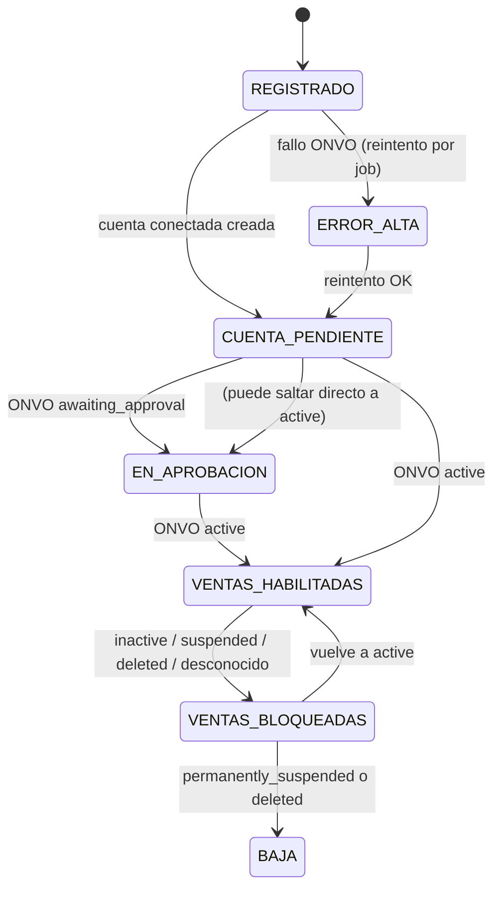

# HotClick — Diseño de automatización ONVO: negocios, cuentas conectadas y planes (23-oct-2026)

Este documento es un diseño, no un inventario. Lo que ya está investigado lo remito a:
- **[A]** `HotClick-ONVO-analisis-2026-10-23.md`: capacidades de ONVO, brechas con el código y reglas.
- **[P]** `HotClick-ONVO-profundizacion.md`: requests exactos, errores, estados, price IDs y el caso Emprendedor.
- **[O]** `HotClick-ONVO-oportunidades.md`: funciones adicionales.

Las citas a la doc de ONVO (docs.onvopay.com) están en esos archivos; acá solo nombro la sección cuando agrego algo. Uso la etiqueta **ND** para lo que la doc no documenta. No incluyo código, llamadas live, secretos ni datos personales.

## 1. Principios
1. **Fail-closed.** Sin llave, sin webhook secret, con una cuenta conectada que no esté `active`, una suscripción que no esté `active`/`trialing` o un estado desconocido, no se cobra en nombre del negocio ni se activa un plan pago [A §5].
2. **Fuente de verdad doble.** Un webhook o un GET de reconciliación confirma; la redirección nunca confirma nada.
3. **Idempotencia local.** ONVO no documenta ninguna idempotency key [P §1.5], así que toda creación pasa por una fila "intención" en Postgres con restricción única antes de llamar a ONVO.
4. **Separación de roles.** La **cuenta conectada** sirve para que el negocio venda. El **customer + subscription** de la cuenta primaria sirve para que HotClick le cobre el plan al negocio [A §2].
5. **Test y live separados.** Toda fila ONVO lleva `mode`, porque los objetos no se pueden pasar de un modo al otro [P §1.4].

## 2. Flujo de punta a punta

```mermaid
sequenceDiagram
    autonumber
    actor D as Dueño del negocio
    participant H as HotClick (Spring Boot)
    participant DB as Postgres
    participant O as ONVO API
    participant J as Jobs @Scheduled

    D->>H: Registra negocio + elige plan
    H->>DB: INSERT empresa (estado=REGISTRADO)
    H->>DB: Reserva cupo Emprendedor gratis (si aplica, transacción con lock)
    H->>DB: INSERT onvo_operacion (tipo=CREAR_CUENTA, clave única empresa+mode)
    H->>O: POST /v1/connected-accounts {businessName, marketplaceAppFee}
    O-->>H: 201 {id, status=pending_onboarding, onboardingUrl}
    H->>DB: Guarda onvo_cuenta_conectada (sin onboardingUrl)
    H-->>D: Muestra onboardingUrl en sesión (no se persiste ni loguea)
    D->>O: Completa onboarding alojado (IBAN, KYC: ND)
    Note over O: awaiting_approval → active (quién aprueba/tiempos: ND)
    J->>O: GET /v1/connected-accounts?status=... (sin webhook de cuenta: ND)
    J->>DB: Actualiza estado; si active → empresa VENTAS_HABILITADAS
    alt Plan pago (PYME, Negocio Plus, o Emprendedor desde el negocio 71)
        D->>H: Ingresa tarjeta (ONVO.js / llave publicable)
        H->>O: POST /v1/customers (si no existe) + payment method
        H->>DB: INSERT onvo_operacion (tipo=CREAR_SUSCRIPCION)
        H->>O: POST /v1/subscriptions {customerId, paymentMethodId, items[priceId], metadata}
        O-->>H: webhook payment-intent.* / subscription.renewal.*
        H->>O: GET /v1/subscriptions/{id} (verificación)
        H->>DB: plan ACTIVO
    else Emprendedor gratis (cupo de 70)
        H->>DB: plan ACTIVO_GRATIS (sin objeto en ONVO)
    end
    J->>O: GET /v1/invoices, /v1/subscriptions/{id} (reconciliación)
    J->>DB: Degrada si past_due/unpaid/canceled
```

## 3. Máquinas de estados

### 3.1 Negocio (lado HotClick)

El estado del plan es independiente: `SIN_PLAN → ACTIVO_GRATIS | PENDIENTE_PAGO → ACTIVO → MOROSO → CANCELADO`. Se cruzan solo en la regla de visibilidad que defina negocio. **No está decidido:** si un negocio con plan moroso puede seguir vendiendo. Lo tiene que definir Andrés.

### 3.2 Cuenta conectada (espejo del `status` de ONVO)
| ONVO `status` | Estado HotClick | ¿Cobrar con `onBehalfOf`? |
|---|---|---|
| `pending_onboarding` | CUENTA_PENDIENTE | No |
| `awaiting_approval` | EN_APROBACION | No |
| `active` | VENTAS_HABILITADAS | **Sí** |
| `inactive`, `temporally_suspended` | VENTAS_BLOQUEADAS | No |
| `permanently_suspended`, `deleted` | BAJA | No |
| Cualquier otro | VENTAS_BLOQUEADAS + alerta | No |

El significado exacto de cada estado y sus transiciones son **ND** [P §1.2]. El orden del diagrama es una inferencia y el código no debe depender de él: solo reacciona al valor actual.

### 3.3 Suscripción (espejo de ONVO)
Los estados de ONVO son `active`, `past_due`, `canceled`, `unpaid`, `incomplete`, `incomplete_expired` y `trialing` [P §2.4].
- `active` y `trialing` → plan ACTIVO.
- `past_due` → MOROSO, con gracia configurable.
- `unpaid`, `canceled` e `incomplete_expired` → CANCELADO, que degrada a SIN_PLAN.
- `incomplete` → PENDIENTE_PAGO.

## 4. Modelo de datos (migraciones Flyway aditivas)
Usan el siguiente número libre después de la última migración existente y se replican en `Actualizado.sql` [A §5]. Ninguna migración modifica ni borra columnas que ya existen.

| Migración | Tabla / cambio | Columnas clave | Restricciones |
|---|---|---|---|
| M1 | `onvo_cuenta_conectada` (nueva) | `id` PK, `empresa_id` FK, `mode` (test/live), `onvo_account_id`, `status_onvo`, `business_name_enviado`, `marketplace_app_fee`, `onboarding_link_generado_en`, `ultimo_sync_en`, `creado_en`, `actualizado_en` | UNIQUE(`empresa_id`,`mode`); UNIQUE(`onvo_account_id`); `onvo_account_id` puede ser nulo mientras la operación está en curso. **No hay columna para `onboardingUrl`.** |
| M2 | `onvo_operacion` (nueva, registro de idempotencia) | `id`, `tipo` (CREAR_CUENTA, CREAR_CUSTOMER, CREAR_SUSCRIPCION, REGENERAR_LINK, CREAR_PRECIO), `clave_negocio` (por ejemplo `empresa:123:live`), `estado` (EN_CURSO, OK, FALLIDA, INCIERTA), `onvo_id_resultado`, `intentos`, `ultimo_error_code`, `creado_en`, `actualizado_en` | UNIQUE(`tipo`,`clave_negocio`) |
| M3 | `onvo_suscripcion` (nueva, o se amplía la de `V114__billing_onvo.sql` si ya cubre esto; hay que revisarla antes) | `empresa_id`, `mode`, `plan`, `onvo_customer_id`, `onvo_subscription_id`, `onvo_price_id`, `status_onvo`, `periodo_fin`, `cancel_at_period_end`, `ultimo_sync_en` | UNIQUE(`empresa_id`,`mode`) mientras esté vigente |
| M4 | `onvo_evento_webhook` (nueva) | `id`, `tipo`, `objeto_id`, `hash_payload`, `recibido_en`, `procesado_en`, `resultado` | UNIQUE(`tipo`,`objeto_id`,`hash_payload`), para deduplicar porque el payload no trae un event id (**ND**) |
| M5 | `plan_cupo_gratis` (ya existe el cupo V127 [A §2]; solo se agregan columnas si faltan) | `empresa_id`, `plan`, `asignado_en`, `liberado_en` | Tope de 70 garantizado en la transacción (ver §7) |

## 5. Jobs de reconciliación (`@Scheduled`, con lock distribuido o ShedLock si hay más de una instancia)
| Job | Frecuencia sugerida | Qué hace | Endpoint |
|---|---|---|---|
| J1 `SyncCuentasConectadas` | Cada 15 min | Recorre cuentas en estados no terminales, pagina con `cursorNext` y actualiza `status_onvo` y el estado HotClick. Alerta si aparece un estado desconocido. | `GET /v1/connected-accounts?status=…`, `GET /{id}` |
| J2 `RecordatorioOnboarding` | Diario | Si el enlace tiene más de 6 días y la cuenta sigue en `pending_onboarding`, le muestra al dueño un aviso en el panel con el botón "regenerar". No manda el enlace por correo. | `POST /{id}/onboarding-link` (a demanda) |
| J3 `ResolverOperacionesInciertas` | Cada 10 min | Toma las `onvo_operacion` en EN_CURSO por más de 5 min o en INCIERTA. Si es una cuenta, lista y compara `businessName` + ventana de `createdAt`. Si no la puede resolver, la marca para revisión manual. **Nunca crea un duplicado a ciegas.** | `GET /v1/connected-accounts` |
| J4 `SyncSuscripciones` | Cada hora | Revisa suscripciones con `periodo_fin` vencido o en estados no terminales, porque no hay webhooks de cancelación ni de fin de trial (**ND**) [P §2.4]. | `GET /v1/subscriptions/{id}` |
| J5 `ConciliarRenovaciones` | Diario | Compara las renovaciones `paid` con los períodos activos en Postgres [O P0]. | `GET /v1/invoices?subscriptionId=…` |
| J6 `ReintentoAlta` | Cada 30 min | Reintenta las operaciones FALLIDA con error reintentable (`500`, timeout, `error_creating_onboarding_link`), con backoff y un máximo de N intentos. | — |

Todos los jobs leen la llave según el perfil, nunca registran payloads con datos personales ni enlaces, y emiten métricas: atrasos, desconocidos e intentos.

## 6. Idempotencia (cómo se crea cada objeto)
1. En la transacción 1 se hace el INSERT en `onvo_operacion` como EN_CURSO. Si viola la restricción única, se lee la existente y se devuelve su resultado o su estado.
2. Se llama a ONVO **fuera** de esa transacción, con timeout corto.
3. En la transacción 2, según el resultado:
   - Con 2xx se guarda `onvo_id_resultado` y la operación queda OK.
   - Con un 4xx no reintentable queda FALLIDA con su `code`.
   - Con timeout o 5xx queda INCIERTA y la resuelve J3.
4. Los webhooks se deduplican con M4, y el procesamiento es "upsert por estado". Nunca se usa un contador.
5. Productos y precios: el script lista primero y crea solo lo que falta [P §2.2].

## 7. Cupo de 70 Emprendedor gratis
- El diseño recomendado es no crear la suscripción en ONVO para los primeros 70 [P §2.3]: los cupones no aplican a suscripciones y un precio en 0 es **ND**.
- La asignación se hace en una transacción `SERIALIZABLE`, o con `SELECT … FOR UPDATE` sobre una fila contador. Hay que verificar `count < 70` e insertar en `plan_cupo_gratis` en la misma transacción.
- El negocio 71 en adelante recibe Emprendedor pago (price de USD 9).
- **Decisiones de negocio pendientes:**
  - ¿El cupo se libera si un negocio se da de baja?
  - ¿Lo gratis es para siempre o temporal? Si es temporal, se usaría `trialPeriodDays` o `startDate` [P §2.3], con la condición de probar en test qué pasa al terminar (**ND**).
  - ¿Un negocio gratis que pasa a PYME pierde su cupo?

## 8. Puntos manuales (no automatizables según la doc)
- Habilitar Marketplace en la cuenta primaria. Es comercial y se coordina con ONVO.
- El onboarding y KYC del vendedor, que se hace en la página alojada de ONVO; los requisitos son **ND**.
- La aprobación de la cuenta: quién la hace y cuánto tarda es **ND**.
- Registrar los webhooks y su secret en el Dashboard.
- Crear los precios en live, que requiere el OK de Andrés [A §5].
- Resolver las operaciones INCIERTAS que J3 no pudo cerrar.
- Bajas de cuentas conectadas: no hay endpoint de borrado documentado.

## 9. Riesgos
| Riesgo | Mitigación |
|---|---|
| Cuenta duplicada en ONVO por timeout | `onvo_operacion` + J3, sin reintentos a ciegas |
| Fuga del `onboardingUrl` | No se persiste ni se loguea; se muestra solo al dueño autenticado y se regenera a demanda |
| Estados o transiciones de ONVO distintos a lo supuesto | Mapeo de §3.2 con default bloqueado y alerta por estado desconocido |
| Webhooks perdidos o eventos sin documentar | Jobs J4 y J5; se eliminan los handlers de eventos no documentados [A §4] |
| Cupo 70 sobreasignado por concurrencia | Lock y transacción serializable, más un test de concurrencia |
| Mezcla test/live | `mode` en todas las tablas y fallo al arrancar si la llave y el perfil no coinciden |
| Polling que se topa con límites de tasa | Rate limits **ND**: backoff y frecuencias moderadas |
| Precios en USD no aceptados en recurrentes | Validarlo en test primero [P §2.1] |
| Dependencia comercial con ONVO | Feature flag `hotclick.onvo.marketplace.enabled=false` hasta tener la confirmación |

## 10. Orden de implementación
| Fase | Alcance | Criterio de salida |
|---|---|---|
| **F0 – Prerrequisitos** | Confirmar con ONVO Marketplace, USD en recurrentes y las preguntas ND [P §4]. Decisiones de negocio de §7 y comisiones por plan. | Respuestas por escrito y OK de Andrés |
| **F1 – Datos e idempotencia** | Migraciones M1–M4 (más M5 si hace falta), `onvo_operacion`, mapeo de errores [P §1.3] | Migraciones aplicadas en dev y tests verdes |
| **F2 – Planes** | Script idempotente de productos y precios (test), cupo 70, alta de suscripción, J4, J5, limpieza de handlers de webhook | E2E en modo test: alta pagada, gratis, renovación fallida y degradación |
| **F3 – Cuentas conectadas** | Alta al registrar el negocio, entrega del enlace, J1, J2, J3, J6, regla de `onBehalfOf` solo con `active` | E2E en test con cuentas en cada estado posible |
| **F4 – Ventas por negocio** | Payment intents y Checkout con `onBehalfOf`; filtro `onvo-on-behalf-of` en el panel | Split verificado en test |
| **F5 – Live** | Crear precios live, activar los flags por etapas (primero negocios piloto) | OK individual de Andrés en cada paso |

## 11. Otras funciones de ONVO que conviene adoptar (resumen; el detalle está en [O])
- **Junto con F2/F3 (P0):**
  - Motivos estructurados de rechazo de tarjeta, para mensajes claros en el alta del plan.
  - `GET /v1/invoices` como base de J5.
  - Historial por cliente para soporte.
- **Después de F2 (P1):**
  - Autoservicio del plan con `cancelAtPeriodEnd` y upgrade/downgrade por items. Tiene vacíos ND: el prorrateo y el cambio de tarjeta.
  - Expirar sesiones de Checkout abandonadas.
  - Tests en CI con los escenarios de prueba de ONVO.
- **Opcional (P2):** 3DS modal, idioma del SDK y verificación de métodos de pago.
- **No planificar:** webhook de reembolsos, disputas y API de payouts (no existen en la doc) [O, sección final].
